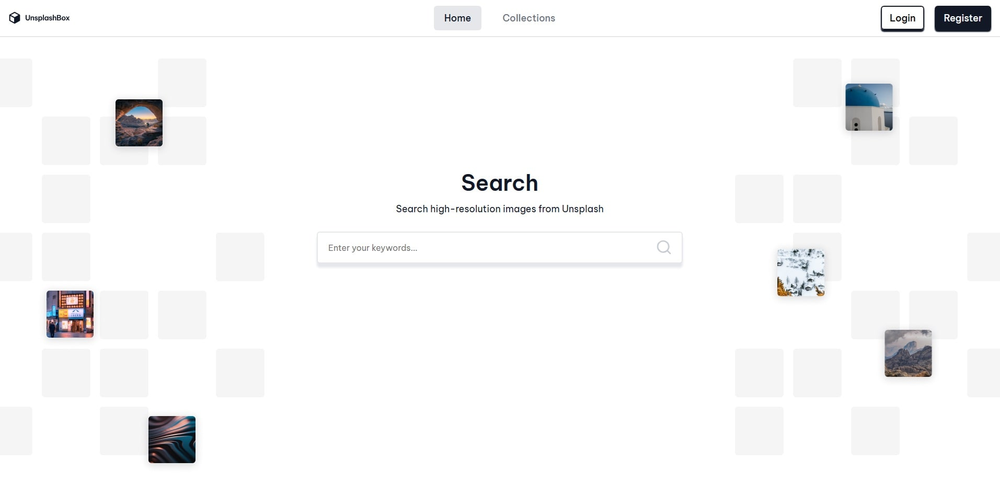

# UnsplashBox

UnsplashBox is a full-stack Unsplash-inspired image search application. The frontend uses the Unsplash API to search and display photos, while the backend handles user authentication, profile image updates, and user-created image collections.

Users can search for high-resolution images, open image details, download images, register and log in, create collections, and save selected images to their own collections.

## Live Demo

https://unsplashbox-frontend.onrender.com/

## Preview



## Features

- Search images using the Unsplash API
- Search result page with paginated loading
- Masonry-style image grid
- Image detail page
- Display image author information
- Link to the original Unsplash author profile
- Download images through the Unsplash download flow
- User registration
- User login and logout
- JWT-based authentication stored in an HTTP-only cookie
- User state stored on the frontend with Zustand and `sessionStorage`
- Profile page with username and account creation date
- Profile image upload/update with Cloudinary
- Create user collections
- View all user collections
- View a single collection
- Delete collections
- Add images to collections
- Remove images from collections
- Toast notifications for user feedback
- Loading states for asynchronous actions
- Lazy-loaded pages with React `lazy` and `Suspense`
- Responsive UI components

## Tech Stack

### Frontend

- React
- TypeScript
- Vite
- React Router
- TanStack React Query
- React Query Devtools
- Zustand
- React Hook Form
- React Toastify
- React Masonry CSS
- React Responsive
- Motion
- Lucide React
- Unsplash API

### Backend

- Node.js 24.22.1
- Express
- TypeScript
- MongoDB
- Mongoose
- JWT
- bcrypt
- cookie-parser
- CORS
- Cloudinary
- dotenv

## Project Structure

```txt
UnsplashBox---Unsplash-copy/
├── backend/
│   ├── src/
│   │   ├── configs/
│   │   │   ├── cloudinary.config.ts
│   │   │   └── db.config.ts
│   │   ├── controllers/
│   │   │   ├── auth.controller.ts
│   │   │   └── collection.controller.ts
│   │   ├── middlewares/
│   │   │   └── auth.middlewares.ts
│   │   ├── models/
│   │   │   ├── collection.model.ts
│   │   │   └── user.model.ts
│   │   ├── routes/
│   │   │   ├── auth.route.ts
│   │   │   └── collection.route.ts
│   │   ├── utils/
│   │   │   └── auth.util.ts
│   │   └── server.ts
│   ├── package.json
│   └── tsconfig.json
│
├── frontend/
│   ├── public/
│   ├── src/
│   │   ├── api/
│   │   │   ├── authApi.ts
│   │   │   ├── collectionsApi.ts
│   │   │   ├── imageApi.ts
│   │   │   └── searchApi.ts
│   │   ├── components/
│   │   ├── features/
│   │   │   ├── authentication/
│   │   │   ├── collections/
│   │   │   ├── imageDetails/
│   │   │   ├── imageSearch/
│   │   │   └── userProfile/
│   │   ├── pages/
│   │   │   ├── CollectionPage/
│   │   │   ├── CollectionsPage/
│   │   │   ├── HomePage/
│   │   │   ├── ImagePage/
│   │   │   ├── PageNotFound/
│   │   │   ├── ProfilePage/
│   │   │   └── SearchPage/
│   │   ├── stores/
│   │   ├── types/
│   │   ├── utils/
│   │   ├── App.tsx
│   │   ├── index.css
│   │   └── main.tsx
│   ├── package.json
│   └── vite.config.ts
│
└── README.md
```

## Getting Started

### Prerequisites

Make sure you have installed:

- Node.js
- npm
- MongoDB database, local or hosted
- Unsplash API access key
- Cloudinary account, if you want to use profile image uploads

## Installation

Clone the repository:

```bash
git clone https://github.com/AcePeQ/UnsplashBox---Unsplash-copy.git
cd UnsplashBox---Unsplash-copy
```

## Backend Setup

Go to the backend folder:

```bash
cd backend
npm install
```

Create a `.env` file inside the `backend` folder:

```env
PORT=5000
MONGODB_URL=your_mongodb_connection_string
JWT_SECRET_KEY=your_jwt_secret_key
NODE_ENV=development

CLOUDINARY_NAME=your_cloudinary_cloud_name
CLOUDINARY_KEY=your_cloudinary_api_key
CLOUDINARY_SECRET_KEY=your_cloudinary_api_secret
```

Run the backend in development mode:

```bash
npm run start:dev
```

Build the backend:

```bash
npm run build
```

Start the production build:

```bash
npm run start:prod
```

Or build and start with:

```bash
npm start
```

## Frontend Setup

Go to the frontend folder:

```bash
cd frontend
npm install
```

Create a `.env` file inside the `frontend` folder:

```env
VITE_UNSPLASH_ACCESS_KEY=your_unsplash_access_key
VITE_API_BASE_URL=http://localhost:5000
```

Run the frontend in development mode:

```bash
npm run dev
```

Build the frontend:

```bash
npm run build
```

Preview the production build:

```bash
npm run preview
```

## Available Scripts

### Backend

Run these commands inside the `backend/` folder:

```bash
npm run start:dev   # Start backend in development mode with nodemon and ts-node
npm run build       # Compile TypeScript
npm run start:prod  # Start compiled backend from dist/server.js
npm start           # Build and start the backend
```

### Frontend

Run these commands inside the `frontend/` folder:

```bash
npm run dev      # Start Vite development server
npm run build    # Compile TypeScript and build the app
npm run preview  # Preview the production build
npm run lint     # Run ESLint
```

## API Overview

### Authentication

```txt
POST /api/auth/register
POST /api/auth/login
POST /api/auth/logout
POST /api/auth/update-profile-image
```

The `update-profile-image` route is protected with JWT middleware.

### Collections

```txt
GET  /api/collection/collections
GET  /api/collection/collection?collection_name=<collection_name>
GET  /api/collection/image-collections?image_id=<image_id>
POST /api/collection/create-collection
POST /api/collection/delete-collection
POST /api/collection/add-image-to-collection
POST /api/collection/delete-image-from-collection
```

Collection routes are protected with JWT middleware.

### Unsplash API

The frontend calls the Unsplash API directly for:

```txt
GET https://api.unsplash.com/search/photos
GET https://api.unsplash.com/photos/:imageId
```

The app also uses the Unsplash download location from image data before downloading a photo.

## Data Models

The backend uses MongoDB collections for:

- Users
- Collections

A user contains authentication data, username, optional profile picture, and timestamps.

A collection belongs to a user and stores saved image objects with data such as image ID, image URL, author name, author profile link, creation date, alt text, and download link.

## Environment Variables

### Backend

| Variable | Description |
|---|---|
| `PORT` | Backend server port |
| `MONGODB_URL` | MongoDB connection string |
| `JWT_SECRET_KEY` | Secret key used to sign JWT tokens |
| `NODE_ENV` | Application environment, for example `development` or `production` |
| `CLOUDINARY_NAME` | Cloudinary cloud name |
| `CLOUDINARY_KEY` | Cloudinary API key |
| `CLOUDINARY_SECRET_KEY` | Cloudinary API secret |

### Frontend

| Variable | Description |
|---|---|
| `VITE_UNSPLASH_ACCESS_KEY` | Unsplash API access key |
| `VITE_API_BASE_URL` | Base URL of the backend API |

## Notes

The frontend Vite config includes a development proxy from `/api` to:

```txt
http://localhost:5000
```

The backend CORS configuration currently uses a hardcoded production frontend origin. If you deploy the project somewhere else, or if local requests do not work as expected, adjust the CORS origin configuration.

## Author

Created by [AcePeQ](https://github.com/AcePeQ).
